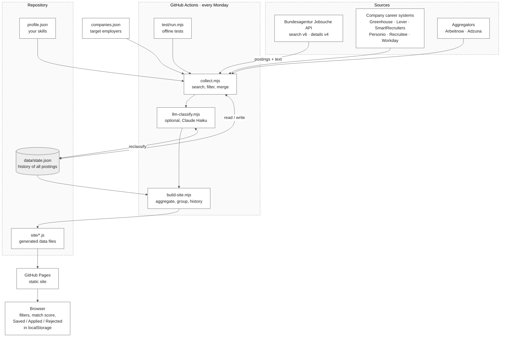

# jobwatch

A weekly job-market tracker for Germany. It collects postings from the Bundesagentur für Arbeit job board, keeps a snapshot history, and publishes a static site where you can search, filter and track jobs.

It covers two domains plus theses:

| Domain | Scope |
|---|---|
| **A** | Data science, BI, ML, NLP, AI |
| **B** | Industry 4.0, electrical engineering, automation, robotics |
| **Theses** | Master / Bachelor / Abschlussarbeit postings in either domain |

No server, no database, no accounts. The collector is a Node script, the history is one JSON file in the repo, and the site is plain HTML and JS.

## Sources

| Source | What it adds | Setup |
|---|---|---|
| Bundesagentur für Arbeit | Broad coverage, mostly small and mid-size employers | none |
| Company career systems | Postings straight from big employers' own hiring systems | `companies.json` + `node discover.mjs` |
| Arbeitnow | German postings from several boards | none |
| Adzuna | Aggregated German postings | free key: set `ADZUNA_APP_ID` and `ADZUNA_APP_KEY` |

Big corporates barely post on the Agency board (a check of Siemens, BMW, Bosch, Mercedes and Bayer returned zero exact-name matches), so for them the career-system route is the one that matters. Postings found by more than one source are merged by title, company and city. Each card shows where it came from.

**LinkedIn, StepStone, Indeed and Glassdoor are not sources.** Their terms forbid scraping and they block bots. This project does not try to get around that.

### Adding companies

`companies.json` lists ~140 large employers in Germany (DAX, big banks, consultancies, automation and robotics firms, retail). Each entry has a `sources` list that starts empty.

```bash
node discover.mjs                       # probes Greenhouse, Lever, SmartRecruiters, Recruitee, Personio
node discover.mjs --accept "SAP,Bayer"  # after checking the printed company names are right
node discover.mjs --accept-all
node discover.mjs --only "Siemens"      # re-probe one company
```

Matches are only *candidates* until you accept them, because a slug can belong to a different company with a similar name.

Most large German corporates (Siemens, BMW, Bosch, Mercedes, Deutsche Bank and others) run on enterprise systems that slug-guessing can't find. Workday sites can be added by hand once you know the address from the career site's URL:

```json
{ "ats": "workday", "host": "company.wd3.myworkdayjobs.com", "tenant": "company", "site": "External" }
```

For everything else, `detect.mjs` reads each company's career-page URL (from `careers.json`) and looks for a Workday address, a known hiring system, or a sitemap whose job pages carry schema.org `JobPosting` data. The last case works with a generic adapter (`jsonld`), and many SAP SuccessFactors, Phenom and custom career sites publish exactly that.

```bash
node detect.mjs                      # companies that have a URL in careers.json and no sources yet
node detect.mjs --only "SAP"
node detect.mjs --accept "SAP,Bayer" # after reading what it found
```

Where `detect.mjs` finds nothing readable, the career site renders its jobs in JavaScript behind a private API. Those need a company-specific adapter in `lib/ats.mjs`. Check `robots.txt` and the site's terms before adding one.

## What you get

- **Hiring map, companies, statistics:** postings per state, per city square, per employer, per week.
- **CV match score:** keyword overlap between a posting and the skills in `profile.json`.
- **German-required filter:** read from the posting text, with the title as a fallback when no text was fetched.
- **Staffing firms** (FERCHAU, Hays, Brunel and similar) are tagged and can be hidden.
- **Duplicate grouping:** the same title and company across several cities shows as one card.
- **My jobs:** mark postings Saved, Applied or Rejected. Stored in your browser only.
- **Real history:** after two or more weekly runs, the site shows open-posting counts per snapshot and which postings closed.

## How it works



Each weekly run reads `data/state.json`, merges the new snapshot into it, and commits it back. That file is the only thing that persists between runs.

Run weekly by `.github/workflows/weekly.yml`, or by hand.

**Closing logic.** The API returns at most 500 results per search term, so a posting can disappear from one run without being closed. A posting is marked closed only after it is missing from two consecutive complete runs. A run counts as incomplete if more than 10% of the searches fail, and incomplete runs never close anything.

## Requirements

- Node.js 20 or newer (`node -v` to check)
- Python 3 or any static file server, only to view the site locally
- A GitHub account, only if you want the weekly automation

## Quick start (local)

```bash
git clone <your-repo-url> jobwatch
cd jobwatch

node test/run.mjs          # offline tests, no network
node collect.mjs           # real data from the API
node build-site.mjs        # writes site/*.js
cd site && python -m http.server 8000
```

Open http://localhost:8000.

On Windows PowerShell, set variables like this before `node collect.mjs`:

```powershell
$env:MAX_DETAILS=20
```

The first full run takes a while: roughly 40 search terms with paging, then up to 300 job-detail requests, all rate-limited on purpose. Use a small `MAX_DETAILS` for a quick trial.

`build-site.mjs` refuses to run if `data/state.json` is empty, so you can't overwrite the site with zeros.

## Run it weekly on GitHub

1. Create a GitHub repo and push this folder.
2. Settings → Pages → Source: **GitHub Actions**.
3. Actions → *weekly-collect-and-deploy* → **Run workflow**.
4. From then on it runs every Monday at 05:17 UTC.

Each run executes the offline tests first, collects, builds, commits `data/state.json` back to the repo, and deploys `site/`. The history lives in that committed file, so don't delete it.

Optional: add a repository secret named `ANTHROPIC_API_KEY`. The workflow then asks Claude (Haiku) to re-classify postings that matched both domains. Without the secret that step is skipped.

## Configuration

| What | Where |
|---|---|
| Your skills, used for the match score | `profile.json` → `skills` |
| Search terms per domain and thesis | `lib/classify.mjs` → `QUERIES` |
| Domain keyword rules | `lib/classify.mjs` → `RX_A`, `RX_B` |
| Staffing-firm list | `lib/classify.mjs` → `RX_STAFF` |
| German-required patterns | `lib/classify.mjs` → `DE_REQ`, `DE_OPT`, `EN_ONLY` |
| Target employers and their hiring systems | `companies.json` |
| Turn off an aggregator | `sources: { arbeitnow: false }` in `run()` options |
| Time window (default 90 days) | env `SINCE_DAYS` |
| Job-detail fetches per run (default 300) | env `MAX_DETAILS` |

Edit the match skills in `profile.json`, then run the collector again. Scores are computed at collect time, not in the browser.

## Project layout

```
collect.mjs         search + detail fetch, merge into state, closure detection
build-site.mjs      state → site data files (grouping, aggregates, history)
llm-classify.mjs    optional Claude re-classification of ambiguous postings
profile.json        your skills for the match score
lib/ats.mjs         adapters for company career systems and aggregators
companies.json      target employers and their sources
discover.mjs        finds which hiring system each company uses
lib/classify.mjs    queries, regexes, scoring, normalisation (pure functions)
data/state.json     the history (created by the first run)
site/               static site: index.html + generated d0, dca, dcb, dj1, dt, dh .js
test/               offline test with a recorded-shape fixture and mock API
.github/workflows/  weekly job
```

## Data

- **Source:** the Jobsuche service behind arbeitsagentur.de (public, key `jobboerse-jobsuche`). Search uses the `v6` endpoint, job text uses `v4`. The `v6` details endpoint returns 403.
- **Scope:** Germany only. The API also returns Austrian and Swiss postings, which are dropped.
- **Dates:** a posting's date is its first publication date at the Agency. Reposts keep their old date.
- **External postings** have no coordinates; they get a map square and state only when their city already appears in Agency data. External dates are the posting date where the system gives one, otherwise the day it was first seen.
- **Site data:** the list holds the newest 400 postings per domain, thesis list up to 300 per domain. Company tables show the top 150 employers per domain.

## Limits

- **Coverage is partial.** LinkedIn, StepStone, Indeed and Glassdoor are not covered. Company career systems are covered only where an adapter exists and the company is configured. Many large corporates still need a manual Workday entry or a custom adapter.
- **No history on day one.** Net change and closed postings need at least two weekly runs. The weekly counts of a single snapshot undercount older weeks, because postings that already closed are missing.
- **500 results per search term.** Broad terms are cut off, so totals are lower bounds.
- **Keyword classification.** Domains are decided by words in the title and job categories. Some false hits and misses remain. The optional Claude pass only looks at postings that matched both domains.
- **Match score is not fit.** It counts skill keywords, nothing more.
- **German-required needs the posting text.** Only the newest `MAX_DETAILS` postings per run get it. The rest use a title guess until later runs fetch them.
- **Staffing detection is a regex list** and misses firms not on it.
- **No salary, rating, company size or industry.** The source doesn't provide them.
- **Browser-only tracking.** Saved/Applied/Rejected marks are stored in `localStorage`. Clearing site data or switching browser loses them.

## Troubleshooting

| Symptom | Cause / fix |
|---|---|
| `npm` or `node` not recognized | Node isn't installed or the terminal predates the install. Install Node LTS, then fully restart the terminal. |
| Every search logs `0` | The API response format changed or the API is unreachable. The collector now aborts in that case. Print one raw response and check the result key (currently `ergebnisliste`). |
| `data/state.json has no jobs` | Run `node collect.mjs` before `node build-site.mjs`. |
| Site shows `0 postings` or garbled umlauts | Old build. Use the current `site/index.html` and re-run `build-site.mjs`. |
| `FAILED <company>/<system>` in the log | That company's slug or system is wrong or the feed is down. Other sources still run; fix or remove the entry in `companies.json`. |
| `HTTP 403` or `429` in the log | Rate limiting or blocking. Raise `delay` in `collect.mjs`, wait, and retry. |
| Actions run can't push | Settings → Actions → General → Workflow permissions → *Read and write*. |

## Notes on using the API

It's a public but unofficial interface and can change without notice. The collector sends a small delay between requests and a descriptive User-Agent. Keep it that way, and keep the schedule weekly.

## Tests

```bash
node test/run.mjs
```

Runs the collector against a mock API over three simulated weekly runs, plus mocked career-system and aggregator feeds, and checks: domain classification, staffing tags, German-required detection, duplicate grouping, closure after two missed runs, Austria filtering, each adapter's output shape, cross-source de-duplication, and the optional Claude pass with a mocked response. It does not call the real API.
